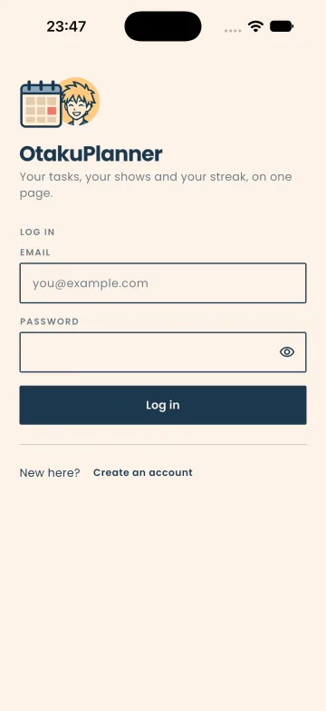
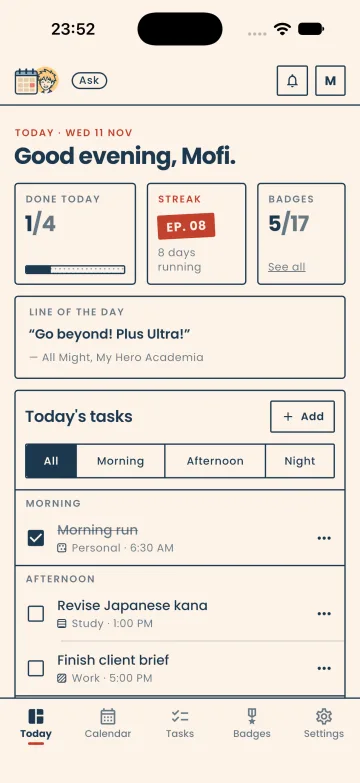
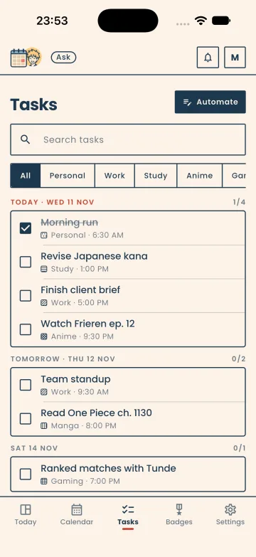
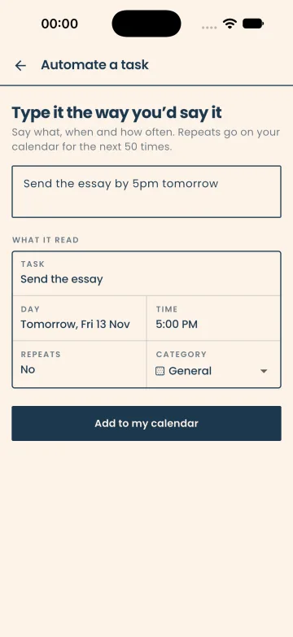
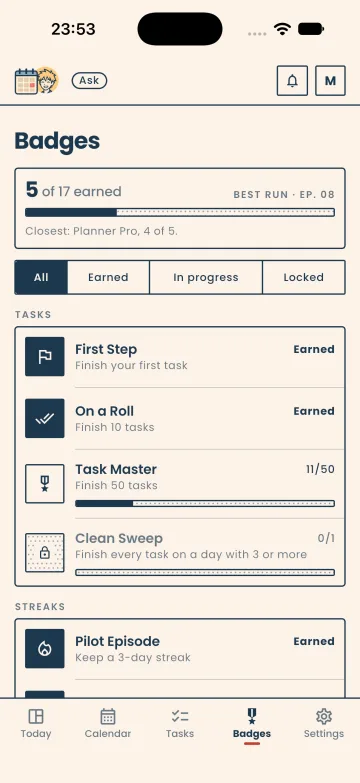

# OtakuPlanner

A Flutter productivity planner for anime fans: schedule tasks on a calendar, set up recurring tasks by typing them in plain English, and keep a streak going with reminders and badges. The interface is drawn like a manga page: navy ink on cream paper, panels instead of cards, screentone instead of colour, and one vermilion stamp for today and the streak.

<p>
  
  
  
  
  
</p>

<sub>Login · Today · Tasks · Natural-language task automation · Badges</sub>

## Features

- **Account and session handling.** Sign up and log in against the OtakuPlanner REST API. The JWT is stored locally with Hive, so returning users skip straight to the dashboard from the splash screen, and an expired session (HTTP 401) sends the user back to login.
- **Today.** A greeting, three stats in one row (done today, the streak as an episode number, badges earned), a line from an anime that changes daily, and today's tasks split into Morning, Afternoon and Night. The streak counts days in a row with at least one finished task.
- **Calendar.** A month calendar built on `table_calendar` where tasks can be added, edited, completed and deleted per day, including editing or deleting every occurrence of a recurring task. Past times are rejected when scheduling.
- **Natural-language task automation.** Type something like "Watch Solo Leveling every Friday at 7:00 PM" and a rule-based parser pulls out the title, weekday or "today/tomorrow", time and whether it repeats. The user picks a category, and the app places the occurrences on the calendar and saves the recurring task to the backend.
- **Tasks and categories.** Every task grouped by day, with full-width search and filters built from the categories the user actually uses. Custom categories can be created from the task sheet and are saved per user on the server; each category gets its own screentone.
- **In-app reminders.** A background timer checks the schedule every minute and raises a notification five minutes before a task starts and again when it is due. Notifications collect in a dropdown with an unread badge.
- **Planning assistant.** Tap the mascot in the top bar. The assistant opens on your day ("3 tasks left today, next at 5:00 PM") and answers through the backend's `/assistant/chat`, which calls Gemini on the server. Suggested tasks appear under the reply and only reach the planner when you tap Add.
- **Badges.** 17 badges worked out from the user's own tasks: totals, streaks, categories and habits such as finishing early or on weekends, with All / Earned / In progress / Locked filters.
- **Profile and settings.** Profile stats from the user's own tasks, a profile photo picked from the gallery, a dark mode that is remembered between launches, and log out.

## Tech stack

| Area | Choice |
| --- | --- |
| Framework | Flutter (Dart SDK `^3.7.2`) |
| State management | `provider` (`ChangeNotifier` + `MultiProvider`) |
| Networking | `dio` for the backend API, `http` for public APIs |
| Local storage | `hive` / `hive_flutter` (auth token, user profile), `shared_preferences` (dark mode) |
| UI | `table_calendar`, Poppins (Regular, Medium, SemiBold, Bold), tokens in `lib/themes/tokens.dart` and shared widgets in `lib/widgets/` |
| Models | `json_annotation` / `json_serializable` (generated `*.g.dart` files) |
| Device | `image_picker` for profile photos |
| Backend | [OtakuPlannerBackend](https://github.com/mofixiu/OtakuPlannerBackend) (Node.js / Express) |
| Assistant | Gemini, called by the backend's `/assistant/chat` (the key stays on the server) |

## Architecture

### State management

`main.dart` initializes Hive and the request service, then wraps the app in a `MultiProvider` with five `ChangeNotifier`s:

| Provider | Responsibility |
| --- | --- |
| `UserProvider` | Username, email, user ID, join date and profile photo, persisted to a Hive box |
| `TaskProvider` | Tasks keyed by date, plus add/edit/delete/complete and recurring-task helpers |
| `CategoryProvider` | Task categories, loaded from and saved to the API |
| `ThemeProvider` | Light/dark `ThemeMode` |
| `NotificationService` | In-app notification list, unread count and toasts |

Screens read and update these with `Provider.of` / `Consumer`. Colours, type, radii and spacing live in `lib/themes/tokens.dart` (read with `context.ink` and `context.type`), and `lib/themes/theme.dart` builds the light and dark `ThemeData` from them.

### Talking to the backend

All API calls go through a singleton `RequestService` in `lib/screens/request.dart`:

- **Base URL.** Set by two constants at the top of the file: `host` (currently a development tunnel URL) and `baseUrl = "$host/api"`. Point `host` at your own running backend.
- **Auth.** `POST /auth/login` and `POST /auth/register` return a token that is saved to a Hive `token` box. A Dio interceptor adds `Authorization: Bearer <token>` to every request outside `/auth/`.
- **Session expiry.** A 401 on a protected route clears the token, shows a "session expired" message and navigates to `/login`.
- **Endpoints used.** `/tasks`, `/users/:id/tasks`, `/recurring-tasks`, `/users/:id/recurring-tasks`, `/categories`, `/users/:id/categories` and `/assistant/chat`.
- **Helpers.** Top-level `get`, `post`, `put` and `delete` functions, plus typed wrappers such as `saveTaskToDatabase`, `updateTaskInDatabase` and `saveRecurringTaskToDatabase`.

## Getting started

### Prerequisites

- Flutter SDK with Dart `^3.7.2` (Flutter 3.29 or later)
- Xcode (iOS) or Android Studio / Android SDK (Android)
- A running instance of the [OtakuPlannerBackend](https://github.com/mofixiu/OtakuPlannerBackend) API

### Run

```bash
git clone https://github.com/mofixiu/OtakuPlanner.git
cd OtakuPlanner
flutter pub get
flutter run
```

### Configuration

- **Backend URL.** Edit `host` in `lib/screens/request.dart` so it points at your backend (for example `http://10.0.2.2:3000` from the Android emulator). The app appends `/api`.
- **Environment files.** None are required. `flutter_dotenv` is listed as a dependency, but no `.env` file is loaded.
- **Generated code.** The `*.g.dart` model files are committed. If you change a model, regenerate them with `dart run build_runner build` after adding `build_runner` as a dev dependency.

## Project structure

```
lib/
├── main.dart                  # App entry: Hive init, providers, theme, routes
├── models/                    # Task, recurring task, category, user, notification (+ generated .g.dart)
├── providers/                 # User, task, category and theme ChangeNotifiers
├── screens/
│   ├── entryScreens/          # Login and sign-up
│   ├── normalMode/            # Today, calendar, tasks, automation, assistant, badges, profile, settings
│   └── request.dart           # Dio API client, auth token handling, endpoint helpers
├── services/                  # Assistant client, plain-English task parser
├── shared/                    # Date/time format, streak and badges, task actions, quotes, notifications, reminders
├── themes/                    # tokens.dart (colours, type, radii, spacing) and the themes built from it
└── widgets/                   # Panel, screentone, stamp, button, segmented control, task row, mascot art, bars
```

## Status

OtakuPlanner was built as a team project. Screens that had no backend behind them (Anime Mode, social sign-in, password reset and change, language and time zone, Premium, two-factor) were removed rather than left as placeholders. Password reset needs a backend route and a mail service before it can come back.

## Credits

Built March to May 2025 by a two-person team.

**Mofiyinfoluwa Ebo** ([@mofixiu](https://github.com/mofixiu)), lead mobile developer. Portfolio: [mofiyinebo.com](https://mofiyinebo.com)

Backend: [mofixiu/OtakuPlannerBackend](https://github.com/mofixiu/OtakuPlannerBackend)
